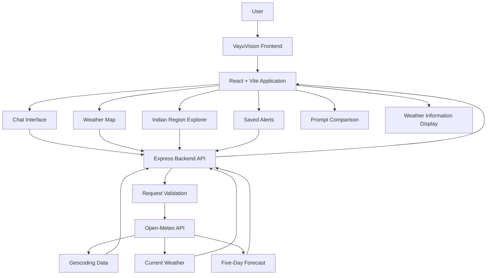
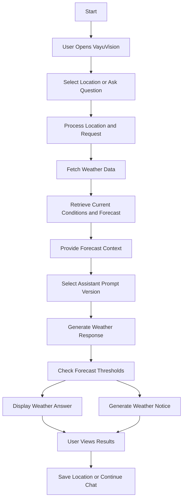
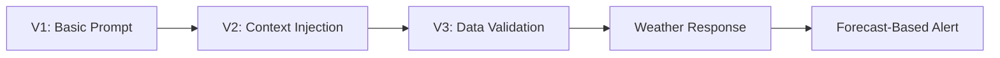

# VayuVision 🌦️
### AI-Powered Weather Assistant for Indian Locations

VayuVision is an intelligent weather assistant designed to make weather information accessible and understandable for users across India. It combines conversational interaction, real-time weather data, five-day forecasting, location exploration, and forecast-based alert generation into a unified application.

Built around the **WeatherGPT — Conversational AI for Weather Forecasting, Alerts & Climate Information (SIH26068)** problem statement, VayuVision demonstrates how prompt engineering, contextual data injection, and structured weather information can improve AI-generated weather responses.

---

## Project Overview

Weather information is often presented as raw meteorological data, making it difficult for ordinary users to interpret and act upon.

VayuVision addresses this by allowing users to:

- Ask weather-related questions in natural language.
- Explore weather conditions across Indian cities, districts, and states.
- View current weather conditions and five-day forecasts.
- Generate weather notices using predefined forecast thresholds.
- Compare three different assistant prompt versions.
- Save locations and access their weather-related information.

## Key Features

| Feature | Description |
|---|---|
| AI Weather Chat | Ask questions about current weather, forecasts, and weather-based conditions. |
| Weather Map | Search Indian locations and explore current conditions and five-day forecasts. |
| Indian Region Explorer | Browse all 28 states and 8 union territories. |
| Location Search | Search locations using Open-Meteo geocoding services. |
| Saved Alerts | Save locations and check forecast-based weather thresholds. |
| Prompt Comparison | Compare V1, V2, and V3 assistant prompt versions. |
| Live Weather Data | Retrieve location and forecast information through the Express API. |

---

## System Architecture

VayuVision follows a client-server architecture where the React frontend communicates with an Express backend, which retrieves location and weather information from Open-Meteo.

### Architecture Diagram



### Application Workflow



---

## Prompt Engineering Methodology

One of the core components of VayuVision is its implementation of three assistant prompt versions.

Each version introduces improvements in how the assistant handles weather-related questions and forecast information.

| Version | Approach | Objective |
|---|---|---|
| V1 | Basic Answer | Generate simple responses to weather questions. |
| V2 | Forecast & Location Context | Incorporate location and forecast information into responses. |
| V3 | Data Checks & Alert Generation | Introduce forecast-based checks and weather alert generation. |

### Prompt Engineering Workflow



The application allows users to compare the three recorded prompt versions. The selected version is saved using browser storage.

---

## Weather Alert System

VayuVision includes a rule-based weather threshold checker that identifies conditions requiring user attention.

### Configured Thresholds

| Weather Parameter | Threshold | Application Behaviour |
|---|---|---|
| Rain Probability | ≥ 70% | Highlights rainfall conditions. |
| Wind Speed | ≥ 50 km/h | Highlights high wind conditions. |
| Temperature | ≥ 40°C | Highlights high temperature conditions. |

**Important:** These thresholds are illustrative application rules. They are not official meteorological warnings or government-issued weather advisories.

Users should verify severe-weather information with the relevant local authorities.

---

## Technology Stack

### Frontend
- React.js
- Vite
- JavaScript
- CSS

### Backend
- Node.js
- Express.js
- REST API

### Weather Data
- Open-Meteo Geocoding API
- Open-Meteo Weather Forecast API

### Browser Storage
- Browser local storage for selected prompt versions and saved locations.

### Development Tools
- npm
- Git
- GitHub

---

## Project Structure

```text
VayuVision/
│
├── backend/
│   └── src/
│       └── server.js
│
├── frontend/
│   ├── public/
│   │   └── favicon.svg
│   │
│   └── src/
│       ├── components/
│       │   └── Shared UI Components
│       │
│       ├── pages/
│       │   ├── Chat
│       │   ├── Map
│       │   ├── Alerts
│       │   └── Prompt Comparison
│       │
│       ├── App.jsx
│       ├── api.js
│       ├── data.js
│       └── styles.css
│
├── package.json
│
└── README.md
```

---

## API Documentation

The Express backend provides the following endpoints.

### 1. Health Check

```http
GET /api/health
```

Checks the availability of the backend API service.

### 2. Location Search

```http
GET /api/locations?query=Pune
```

Searches for Indian locations and returns matching information, including:

- Location names
- Administrative areas
- Coordinates
- Time zones

State and union territory searches return results for their representative cities.

### 3. Weather Forecast

```http
GET /api/weather?latitude=18.52&longitude=73.86
```

Retrieves:

- Current weather conditions
- Five-day weather forecast

The backend validates latitude and longitude before processing requests.

---

## Installation and Setup

### Prerequisites

Make sure the following are installed:

- Node.js 20 or newer
- npm
- Internet connection

### Step 1: Clone the Repository

```bash
git clone https://github.com/naman1021-hub/VayuVision.git

cd VayuVision
```

### Step 2: Install Dependencies

```bash
npm install
```

### Step 3: Start the Application

```bash
npm run dev
```

The development command starts both services.

| Service | Local URL |
|---|---|
| React + Vite Frontend | http://localhost:5173 |
| Express Backend | http://localhost:4000 |

Vite proxies `/api` requests to the Express backend.

### Step 4: Production Build

```bash
npm run build
```

The production frontend bundle is generated inside:

```text
frontend/dist/
```

### Step 5: Run Only the Backend

```bash
npm run start
```

The backend port can be configured through the `PORT` environment variable.

---

## Data Sources

VayuVision uses **Open-Meteo** for location search and weather forecast information.

Official provider:

https://open-meteo.com/

No API key is required for the configured provider requests.

Location coverage depends on the provider's geocoding database and service availability. The application does not include an exhaustive offline database of every Indian locality.

---

## Limitations

- Weather forecasts depend on external provider availability.
- Location coverage depends on the Open-Meteo geocoding database.
- State searches use representative cities rather than providing a complete state-wide forecast.
- Weather alerts are based on predefined thresholds and are not official warnings.
- Forecast information should not be treated as a guarantee of future weather conditions.
- The assistant's responses depend on the available forecast information and implemented prompt logic.

---

## Future Scope

Potential improvements include:

- Integration of official IMD weather warnings.
- Multilingual conversational weather assistance.
- More detailed district-level weather exploration.
- Improved forecast-based alert customization.
- Historical weather analysis.
- Voice-based weather interaction.
- Advanced prompt evaluation and automated response verification.

---

## Project Information

| Detail | Information |
|---|---|
| Project Name | VayuVision |
| Problem Statement | WeatherGPT |
| Problem ID | SIH26068 |
| Organization | Ministry of Earth Sciences |
| Project Category | Conversational AI & Weather Forecasting |
| Project Type | AI-Powered Web Application |
| Course | Prompt Engineering Mini-Project |
| Institution | Bennett University |

### Team Members

| Enrollment Number | Name | Role |
|---|---|---|
| S24CSEU01118 | Naman Gupta | Team Leader |
| S24CSEU0816 | Dhruv Mehta | Team Member |
| S24CSEU1115 | Harshit | Team Member |
| S24CSEU1116 | Prince | Team Member |
| S24CSEU1035 | Prabhsimar Madan | Team Member |
| S24CSEU1190 | Divyansh Tyagi | Team Member |
---

**VayuVision — Making Weather Information Simpler, Smarter, and More Accessible.**
